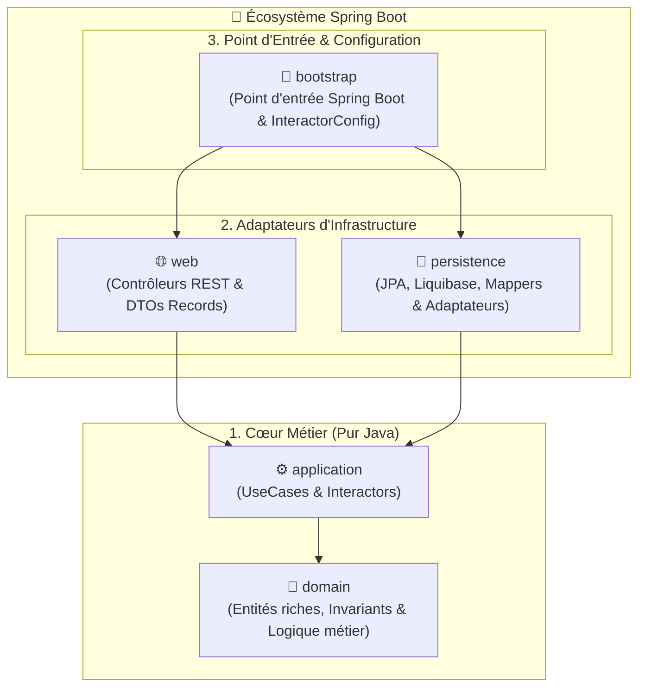

# 🏛️ Kera Demo

🇬🇧 **[English](./README.md)** | 🇫🇷 **Français**

[](https://openjdk.org/projects/jdk/25/)
[](https://spring.io/projects/spring-boot)
[](https://github.com/Felix-Page/Kera)
[](./LICENSE)

> **Application de démonstration de la boîte à outils d'architecture [Kera](https://github.com/Felix-Page/Kera).**  
> *Mise en pratique d'une Clean Architecture stricte en Java 25 / Spring Boot 4, sans le boilerplate habituel.*

---

## 🎯 Présentation

**Kera Demo** (`fr.fpage.kera.demo`) est une application d'exemple conçue pour illustrer concrètement l'utilisation de la boîte à outils d'architecture [Kera](https://github.com/Felix-Page/Kera).

Elle démontre comment construire une application modulaire et découplée où :
* Le **cœur métier (`domain`)** et les **cas d'utilisation (`application`)** restent en **pur Java**, exempts de toute dépendance vers Spring, Hibernate ou Jackson.
* Les couches d'infrastructure (**`persistence`** et **`web`**) tirent parti des briques génériques de Kera (`GenericPort`, `GenericPortImpl`, `AbstractEntityMapper`, `JpaEntityResolver`) pour éliminer le code répétitif (*boilerplate*).

---

## 🚀 Démarrage Rapide

### Prérequis

* **Java** : 25 (ex: Eclipse Temurin via `mise` ou `sdkman`)
* **Maven** : 3.9+
* **Docker** : Docker Engine & Docker Compose

### 1. Installer la boîte à outils Kera en local (Phase Alpha)

Comme Kera est actuellement en phase de développement, commencez par compiler et installer la librairie dans votre cache Maven local (`~/.m2`) :

```bash
git clone --branch v0.1.0 https://github.com/Felix-Page/Kera.git
cd Kera
mvn clean install
cd ..
```

### 2. Cloner et préparer la démo

```bash
git clone https://github.com/Felix-Page/kera-demo.git
cd kera-demo
```

### 3. Démarrer PostgreSQL via Docker Compose

```bash
docker compose -f docker/compose.yaml up -d
```

> [!NOTE]
> Un fichier `docker/.env.example` est fourni. Des valeurs de repli par défaut sont également intégrées dans `compose.yaml` (base : `kera_demo`, port : `5432`, utilisateur : `demo_user`).

### 4. Compiler et Lancer l'Application

Générez le JAR autonome et lancez l'application :

```bash
mvn clean package -DskipTests
java -jar bootstrap/target/bootstrap-*.jar
```

L'application démarre sur `http://localhost:8080`. Au démarrage, Liquibase applique automatiquement le schéma SQL et charge le jeu de données initial.

---

## 🧪 Tester l'API

### Option 1 : Via Slumber (Client HTTP TUI en terminal)

Un fichier de collection [slumber.yml](./slumber/slumber.yml) pré-configuré est fourni. Lancez simplement :

```bash
slumber -f slumber/slumber.yml
```

L'interface interactive vous permet d'exécuter chaque requête en renseignant les portions ou identifiants avec des valeurs par défaut pré-remplies.

---

### Option 2 : Via cURL

#### 1. Lister les agrégats racines (Vue sommaire)
```bash
curl -X GET http://localhost:8080/api/recipes -H "Accept: application/json"
```

#### 2. Consulter un agrégat avec calcul dynamique
Le paramètre `servings` déclenche un recalcul métier des quantités à la volée par le Domaine :

```bash
curl -X GET "http://localhost:8080/api/recipes/22222222-2222-2222-2222-222222222201?servings=8" \
  -H "Accept: application/json"
```

#### 3. Lister les entités autonomes
```bash
curl -X GET http://localhost:8080/api/ingredients -H "Accept: application/json"
```

#### 4. Créer une nouvelle entité
```bash
curl -X POST http://localhost:8080/api/ingredients \
  -H "Content-Type: application/json" \
  -H "Accept: application/json" \
  -d '{"name": "Sucre vanillé"}'
```

#### 5. Supprimer une entité (via deleteById)
L'identifiant `11111111-1111-1111-1111-111111111108` est pré-inséré sans liaison pour tester la suppression immédiate sans contrainte d'intégrité :

```bash
curl -X DELETE http://localhost:8080/api/ingredients/11111111-1111-1111-1111-111111111108
```
*Retourne `204 No Content`.*

---

## 💡 Relations d'Entités & Cas d'Usage Illustrés

Plutôt qu'un simple CRUD à plat qui masquerait la complexité réelle d'un projet, cette démo met en scène les différentes interactions qu'un projet rencontre typiquement entre le modèle du Domaine et les entités de Persistance :

1. **Agrégat racine (`AggregateRoot`)** : `Recipe` fédère ses sous-éléments et garantit la cohérence globale.
2. **Composition & cycle de vie dépendant (`@OneToMany` cascade)** : `RecipeStep` représente des sous-éléments ordonnés dont le cycle de vie est strictement rattaché à l'agrégat parent.
3. **Association avec attributs métier & référence (`@ManyToOne`)** : `RecipeIngredient` porte des métadonnées propres (quantité, unité `Unit`), tout en référençant une entité autonome.
4. **Entité autonome réutilisable (`ReferenceableEntity`)** : `Ingredient` dispose de son propre cycle de vie CRUD indépendant et peut être référencé par plusieurs agrégats sans duplication.

---

## ✨ Ce que démontre Kera dans cette Démo

* **Isolation absolue du Domaine** : Zéro annotation JPA (`@Entity`, `@Id`) ni validation Jakarta dans `domain` et `application`.
* **Réduction drastique du code d'adaptation** :
  - `RecipePersistenceAdapter` ne fait que **6 lignes** en héritant de `GenericPortImpl`.
  - `RecipeEntityMapper` est une **interface de 3 lignes** étendant `AbstractEntityMapper`.
* **Résolution des associations sans `SELECT` superflu** : Grâce à `ReferenceableEntity` et `JpaEntityResolver`, MapStruct associe automatiquement les références via `entityManager.getReference()` sans déclencher de requête SQL inutile.
* **Logique métier riche dans le Domaine** : Recalcul dynamique des quantités selon les paramètres demandés (`RecipeIngredient.scaleQuantity`).
* **Validation à deux niveaux** :
  - *Syntaxique* côté Web : `@Valid`, `@NotBlank`, `@Positive` sur les requêtes REST (`CreateIngredientRequest`, `@RequestParam servings`).
  - *Invariants métier* côté Domaine : validation systématique dans le constructeur et les setters via méthodes `validate<Field>(...)`.
* **Migrations SQL autonomes** : Scripts Liquibase (`db/changelog`) intégrés dans le module `persistence`, garantissant son autonomie pour les schémas SQL et les tests.

---

## 🏗️ Architecture Multi-Modules en Miroir

Le projet suit la symétrie multi-modules standardisée par Kera :



| Module | Rôle & Composants clés | Dépendances |
| :--- | :--- | :--- |
| **`domain`** | Modèles métier purs : `Recipe`, `Ingredient`, `RecipeIngredient`, `RecipeStep`, `Unit`. | **Aucune** (JDK 25 pur) |
| **`application`** | Cas d'utilisation : `GetAllRecipesUseCase`, `GetRecipeByIdUseCase`, `CreateIngredientUseCase`, `DeleteIngredientUseCase` et leurs *Interactors* POJO. | `domain`, `kera-application` |
| **`persistence`** | Entités JPA (`RecipeEntity`, `IngredientEntity`), changelogs Liquibase, `RecipePersistenceAdapter`, `RecipeEntityMapper`. | `domain`, `kera-spring-persistence` |
| **`web`** | Contrôleurs REST (`RecipeController`, `IngredientController`), DTOs `record`, `RecipeDomainMapper`. | `domain`, `application`, `kera-spring-web` |
| **`bootstrap`** | `Bootstrap.java` (`@SpringBootApplication`), câblage IoC (`InteractorConfig.java`), `application.yml`. | Tous les modules, `kera-spring-bootstrap` |

---

## 🤖 Skill Agentique IA Embarqué

Ce projet intègre dans son dossier [`.agents/skills/kera/`](./.agents/skills/kera/) le skill d'ingénierie logicielle officiel de Kera.

Si vous utilisez des assistants IA (Google Antigravity, Cursor, Windsurf, Claude Code), le skill fournit à l'agent :
* Les **Règles d'Or** d'isolation et d'architecture.
* 5 fiches de référence technique détaillant les contrats, annotations et pièges à éviter pour chaque module.
* Un protocole interactif de clarification des invariants avant écriture du code.

---

## 📄 Licence

Ce projet est distribué sous licence **Apache 2.0**. Consultez le fichier [LICENSE](./LICENSE) pour plus d'informations.

---

## 🔗 Liens Utiles

* 🏛️ **Dépôt de la boîte à outils Kera** : [github.com/Felix-Page/Kera](https://github.com/Felix-Page/Kera)
* 👤 **Auteur** : [Félix Page](https://github.com/Felix-Page)
