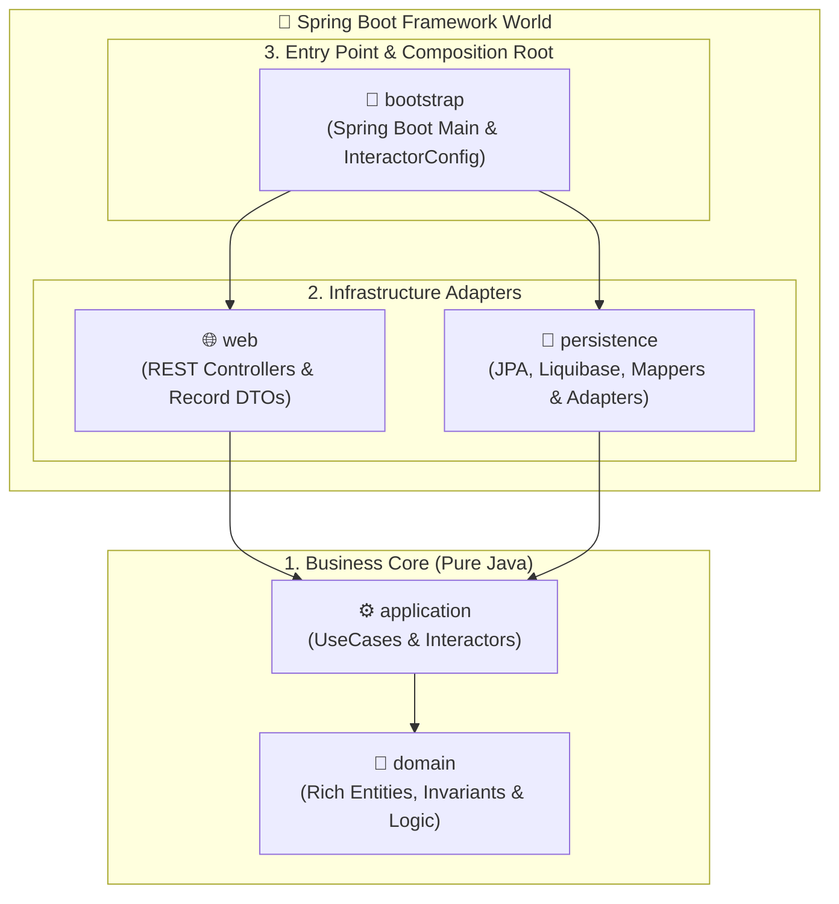

# 🏛️ Kera Demo

🇬🇧 **English** | 🇫🇷 **[Français](./README.fr.md)**

[](https://openjdk.org/projects/jdk/25/)
[](https://spring.io/projects/spring-boot)
[](https://github.com/Felix-Page/Kera)
[](./LICENSE)

> **Showcase demonstration application for the [Kera](https://github.com/Felix-Page/Kera) architectural toolkit.**  
> *Enforcing strict Clean Architecture in Java 25 / Spring Boot 4 without the boilerplate.*

---

## 🎯 Overview

**Kera Demo** (`fr.fpage.kera.demo`) is an example application designed to concretely demonstrate the [Kera](https://github.com/Felix-Page/Kera) architectural toolkit in action.

It shows how to build a modular, decoupled application where:
* The **business core (`domain`)** and **use cases (`application`)** remain in **pure Java**, completely free of dependencies on Spring, Hibernate, or Jackson.
* The infrastructure layers (**`persistence`** and **`web`**) leverage Kera's generic abstractions (`GenericPort`, `GenericPortImpl`, `AbstractEntityMapper`, `JpaEntityResolver`) to eliminate repetitive adapter boilerplate.

---

## 🚀 Quickstart

### Prerequisites

* **Java**: 25 (e.g., Eclipse Temurin via `mise` or `sdkman`)
* **Maven**: 3.9+
* **Docker**: Docker Engine & Docker Compose

### 1. Install the Kera toolkit locally (Alpha Phase)

Since Kera is currently in development, first compile and install the toolkit into your local Maven cache (`~/.m2`):

```bash
git clone https://github.com/Felix-Page/Kera.git
cd Kera
mvn clean install
cd ..
```

### 2. Clone and navigate to the demo

```bash
git clone https://github.com/Felix-Page/kera-demo.git
cd kera-demo
```

### 3. Start PostgreSQL via Docker Compose

```bash
docker compose -f docker/compose.yaml up -d
```

> [!NOTE]
> A `docker/.env.example` file is provided. Default fallback values are also configured in `compose.yaml` (database: `kera_demo`, port: `5432`, user: `demo_user`).

### 4. Build and Run the Application

Generate the standalone executable Fat JAR and start the application:

```bash
mvn clean package -DskipTests
java -jar bootstrap/target/bootstrap-0.1.0-SNAPSHOT.jar
```

The application starts on `http://localhost:8080`. On startup, Liquibase automatically creates the database schema and seeds initial data.

---

## 🧪 Testing the API

### Option 1: Using Slumber (Terminal TUI HTTP Client)

A pre-configured [slumber.yml](./slumber/slumber.yml) collection is included. Simply run:

```bash
slumber -f slumber/slumber.yml
```

The interactive TUI lets you execute each endpoint with pre-filled default values and prompts.

---

### Option 2: Using cURL

#### 1. List aggregate roots (Summary view)
```bash
curl -X GET http://localhost:8080/api/recipes -H "Accept: application/json"
```

#### 2. Get an aggregate root with dynamic calculation
The `servings` parameter triggers on-the-fly business recalculation within the Domain:

```bash
curl -X GET "http://localhost:8080/api/recipes/22222222-2222-2222-2222-222222222201?servings=8" \
  -H "Accept: application/json"
```

#### 3. List autonomous entities
```bash
curl -X GET http://localhost:8080/api/ingredients -H "Accept: application/json"
```

#### 4. Create an autonomous entity
```bash
curl -X POST http://localhost:8080/api/ingredients \
  -H "Content-Type: application/json" \
  -H "Accept: application/json" \
  -d '{"name": "Sucre vanillé"}'
```

#### 5. Delete an entity (via deleteById)
Identifier `11111111-1111-1111-1111-111111111108` is pre-seeded with no active associations to test immediate deletion without foreign key violations:

```bash
curl -X DELETE http://localhost:8080/api/ingredients/11111111-1111-1111-1111-111111111108
```
*Returns `204 No Content`.*

---

## 💡 Entity Relationships & Illustrated Patterns

Rather than a simplistic flat CRUD application that masks real-world complexity, this demo showcases the various boundary interactions a project typically encounters between Domain models and Persistence entities:

1. **Aggregate Root (`AggregateRoot`)**: `Recipe` federates its child elements and guarantees aggregate consistency.
2. **Cascading Composition (`@OneToMany` cascade)**: `RecipeStep` represents ordered child elements whose lifecycle is strictly tied to the aggregate root.
3. **Association with Domain Attributes & Reference (`@ManyToOne`)**: `RecipeIngredient` carries its own metadata (quantity, measurement unit `Unit`), while referencing an autonomous entity.
4. **Autonomous Reusable Entity (`ReferenceableEntity`)**: `Ingredient` possesses its own independent CRUD lifecycle and can be referenced by multiple aggregates without duplication.

---

## ✨ Demonstrated Capabilities

* **Strict Domain Isolation**: Zero JPA annotations (`@Entity`, `@Id`) or Jakarta validation constraints in `domain` and `application`.
* **Drastic Adapter Code Reduction**:
  - `RecipePersistenceAdapter` takes only **6 lines** by extending `GenericPortImpl`.
  - `RecipeEntityMapper` is an empty **3-line interface** extending `AbstractEntityMapper`.
* **Zero Superfluous `SELECT` Queries**: Using `ReferenceableEntity` and `JpaEntityResolver`, MapStruct automatically resolves entity references via Hibernate's `entityManager.getReference()` without triggering redundant SQL queries.
* **Rich Domain Logic**: Dynamic calculations performed directly inside Domain entities (`RecipeIngredient.scaleQuantity`).
* **Two-Level Validation**:
  - *Syntactic validation* at the Web layer: `@Valid`, `@NotBlank`, and `@Positive` on REST requests (`CreateIngredientRequest`, `@RequestParam servings`).
  - *Domain invariants*: systematic enforcement in constructors and setters via private `validate<Field>(...)` methods.
* **Autonomous Database Migrations**: Liquibase changelogs (`db/changelog`) reside inside the `persistence` module, making it self-contained for database schema management and integration tests.

---

## 🏗️ 5-Module Mirror Architecture

The demo follows Kera's standardized multi-module symmetry:



| Module | Role & Key Components | Dependencies |
| :--- | :--- | :--- |
| **`domain`** | Pure domain objects: `Recipe`, `Ingredient`, `RecipeIngredient`, `RecipeStep`, `Unit`. | **None** (Pure JDK 25) |
| **`application`** | Use cases: `GetAllRecipesUseCase`, `GetRecipeByIdUseCase`, `CreateIngredientUseCase`, `DeleteIngredientUseCase` and POJO *Interactors*. | `domain`, `kera-application` |
| **`persistence`** | JPA entities (`RecipeEntity`, `IngredientEntity`), Liquibase changelogs, `RecipePersistenceAdapter`, `RecipeEntityMapper`. | `domain`, `kera-spring-persistence` |
| **`web`** | REST controllers (`RecipeController`, `IngredientController`), `record` DTOs, `RecipeDomainMapper`. | `domain`, `application`, `kera-spring-web` |
| **`bootstrap`** | `Bootstrap.java` (`@SpringBootApplication`), IoC configuration (`InteractorConfig.java`), `application.yml`. | All modules, `kera-spring-bootstrap` |

---

## 🤖 Built-in AI Agentic Skill

This repository includes the official Kera software engineering skill in [`.agents/skills/kera/`](./.agents/skills/kera/).

When using AI coding assistants (Google Antigravity, Cursor, Windsurf, Claude Code), this skill provides:
* **Golden Rules** for layer isolation and dependency directions.
* 5 technical reference sheets detailing contracts, annotations, and best practices per module.
* An interactive clarification protocol for business invariants before code generation.

---

## 📄 License

This project is licensed under the **Apache 2.0 License**. See the [LICENSE](./LICENSE) file for details.

---

## 🔗 Useful Links

* 🏛️ **Kera Architectural Toolkit**: [github.com/Felix-Page/Kera](https://github.com/Felix-Page/Kera)
* 👤 **Author**: [Félix Page](https://github.com/Felix-Page)
